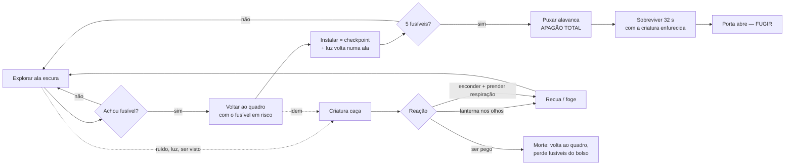
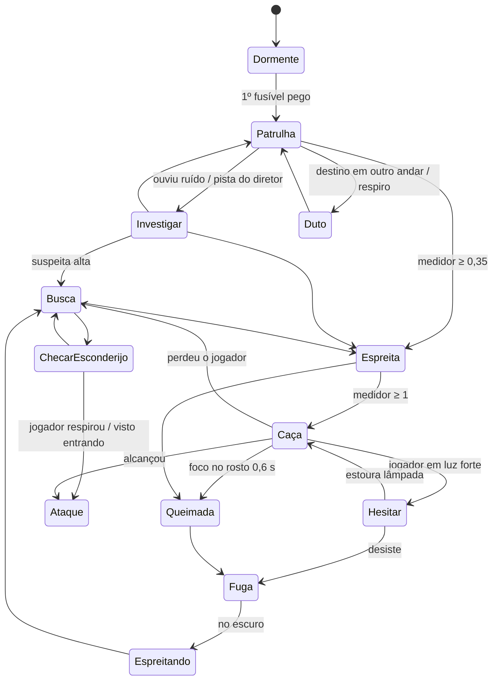

# APAGÃO — Documento de Design (GDD)

**Hospital-Colônia Santa Lúcia · 1983**
Terror em primeira pessoa · exploração, furtividade, perseguição e gerenciamento de luz.

> Este documento descreve o jogo completo e aponta, em cada sistema, onde ele já está implementado no protótipo jogável desta pasta (`src/…`). Todos os números citados vêm de [`src/config.js`](../src/config.js), onde o balanceamento é ajustado.

---

## 1. Conceito geral

### Resumo
Você é um auxiliar funerário que veio buscar um corpo no necrotério de um antigo hospital-colônia psiquiátrico, desativado pela metade. A energia cai. A porta principal tem **trava eletromagnética de contenção**: sem energia, ela não abre. O quadro geral da porta está sem os **cinco fusíveis de porcelana** — alguém os tirou e espalhou pelo prédio.

Algo saiu da **gaveta 13** do necrotério. Os pacientes da antiga "Ala Noturna" o chamavam de **O Noturno**.

### Proposta
Um jogo curto (20–40 min), denso e rejogável, em que **a luz é ao mesmo tempo arma, escudo e isca**:

- A criatura é forte no escuro e hesita na luz.
- A lanterna do jogador é a única defesa — mas denuncia sua posição, esquenta, gasta bateria e só funciona se mirada **nos olhos**.
- Cada fusível instalado devolve luz a uma ala (áreas seguras crescem)… e deixa a criatura mais agressiva.
- No clímax, puxar a alavanca desvia **toda** a energia para a porta: o prédio inteiro apaga e o jogador precisa sobreviver 32 segundos no escuro total.

### Diferenciais
1. **Luz como sistema único e legível** — mapa de luz real alimenta a IA (velocidade, rotas, hesitação), a detecção do jogador e o combate. Nada de números escondidos: o jogador *vê* onde é seguro.
2. **Lanterna com risco e habilidade** — mirar no rosto (0,6 s de exposição) repele; errar a mira enfurece; usar demais superaquece. A criatura **aprende** (protege o rosto com os braços e exige mais tempo de luz).
3. **Olhos que refletem a lanterna** (tapetum) — dois pontos brilhando no fim do corredor são o aviso mais assustador do jogo, e informação útil.
4. **Esconderijos com tensão ativa** — prender a respiração no momento certo, frestas do armário, "ele te viu entrando" invalida o esconderijo.
5. **Animação da criatura gerada por IA de texto → movimento (Kimodo)**, rodando localmente na sua máquina — pipeline reprodutível para gerar novos movimentos em segundos.

---

## 2. Gameplay loop



**Objetivo do jogador:** restaurar a energia da trava da porta principal e sair.

**Como o progresso funciona**
- **Fusíveis no bolso estão em risco**: se a criatura pegar você, eles voltam para onde estavam. **Fusíveis instalados são permanentes** e o quadro salva o progresso (checkpoint). Isso cria o ritmo "sair → achar → voltar correndo".
- Cada fusível instalado religa um **setor de luz** (1 recepção → 2 corredor norte → 3 ala de pacientes + laboratório + farmácia → 4 enfermaria + necrotério + autópsia → 5 segurança + arquivo + almoxarifado). O subsolo **nunca** volta a ter luz de teto.
- A ordem é livre. O mapa ensina a ordem natural (do mais seguro ao mais perigoso), e o **Livro de Ocorrências** (sala de Segurança) lista os esconderijos dos fusíveis para quem o encontrar.

---

## 3. Mecânicas principais

### 3.1 Exploração
- Andar 2,6 m/s · correr 4,9 m/s (≈6 s de estamina, recarga após 1,2 s) · agachar 1,25 m/s.
- **Ruído** é a principal forma de se revelar. Raio em que a criatura ouve (m): andar 4,5 · agachado 1 · correr 13 · passos na água 11 · abrir porta 7 · abrir porta correndo 15 · armário 5 · arfar 10 · instalar fusível 9 · gaveta 7. O som contorna paredes (distância pelo caminho, portas fechadas abafam).
- **Leitura do mundo**: placas acima das portas com o nome da sala; pichações que ensinam as regras ("ELE ODEIA A LUZ", "NOS OLHOS", "ESCONDA-SE", "ELE ANDA PELOS DUTOS"); rastro de sangue arrastado até o necroterio; planta de evacuação na parede da recepção (vira o mapa [M]).
- **Itens brilham quando a lanterna passa por eles** (glint discreto), então vasculhar com a luz é recompensado.

### 3.2 Fusíveis
| # | Onde | Por quê ali | Tensão |
|---|------|-------------|--------|
| 1 | Último quarto à direita da **Ala de Pacientes**, no criado-mudo | Perto do hub, ensina o loop. **Pegá-lo acorda a criatura** (estrondo no necrotério, luzes engasgam) | Baixa → sobe |
| 2 | Carrinho de medicação da **Enfermaria** | Sala grande, leitos com cortinas (esconderijos), porta de serviço para o necrotério | Média |
| 3 | Mesa no fundo do **Arquivo** | Labirinto de estantes: ótimo para despistar, péssimo para enxergar | Média |
| 4 | **Gaveta 13** do Necrotério | É preciso abrir gavetas numeradas (barulho 7 m); pista no laudo de necropsia e no livro do vigia | Alta |
| 5 | Bancada da **Sala do Gerador** (subsolo) | Exige a chave do subsolo (Segurança), descer a escada e atravessar a cisterna alagada ou destravar o atalho | Máxima |

### 3.3 Sistema da porta principal (quadro geral)
1. Quadro na parede da recepção, ao lado da saída: 5 soquetes de porcelana + 5 lâmpadas-piloto (vermelho = vazio, verde = instalado).
2. `E` instala **todos** os fusíveis do bolso (0,55 s cada, com estalo e zumbido crescente). Cada um: checkpoint + setor de luz religado com partida de fluorescente.
3. Com 5/5: **segurar `E` por 1,2 s** puxa a alavanca (o "segurar" evita acidente).
4. **Carga de 32 s**: sirene, apagão total (só as luzes vermelhas de emergência piscando), a criatura entra em modo **enfurecido** (recebe pistas da sua posição a cada 5 s, ignora a luz). As lâmpadas-piloto acendem em sequência.
5. A trava solta: LED verde, as duas folhas abrem, chuva no pátio. Cruzar o pátio = vitória.
6. Morrer durante a carga: volta ao quadro com 5/5 e precisa puxar de novo.

Implementação: `Objectives` em [`src/main.js`](../src/main.js).

### 3.4 Lanterna
| Modo | Como | Efeito | Custo |
|------|------|--------|-------|
| Normal | `F` liga/desliga | Cone de ~24°, 22 m. Explorar, revelar itens, fazer os olhos dele brilharem a até 32 m | Bateria 7 min; **aumenta sua visibilidade** (+0,6) e, se o feixe bater na cara dele, +0,9 |
| Foco | segurar **botão direito** | Cone de ~11°, 30 m, 3× mais forte, carga de 0,22 s | Bateria 9× mais rápida; **calor** +21%/s |
| Queimar | foco **no rosto**, ≤ 9,5 m, dentro de ~11° do centro | 0,6 s contínuos → a criatura grita, cobre o rosto, cambaleia 1,6 s e **foge para o escuro** 6–10 s | Cada repelida aumenta em 35% o tempo necessário (esquece em 50 s) e ela passa a **proteger o rosto** (dano ×0,45, mas anda 25% mais devagar) |
| Errar | foco no **corpo** durante a caça | Nada de dano — ela fica **furiosa** (+15% de velocidade por 3 s) | — |
| Superaquecer | calor 100% | Lanterna **apaga por 3,5 s** (o pior momento possível) | — |
| Bateria fraca (<15%) | — | O feixe falha; `R` bate na lanterna e estabiliza por 2,5 s | — |

Por que não trivializa: exige mira fina, distância curta, tempo contínuo, e todo uso tem custo (bateria, calor, revelar posição, habituação). Ela recua — **não morre**.

Implementação: [`src/entities/flashlight.js`](../src/entities/flashlight.js) + `checkFlashlight()` em [`src/entities/creatureAI.js`](../src/entities/creatureAI.js).

### 3.5 Esconderijos
- **Armários** (15) e **embaixo de camas/macas** (20). `E` entra/sai. Visão pelas frestas (máscara no pós-processamento), olhar limitado a ±35°.
- **Visto entrando = inútil**: se a criatura te vê (ou perdeu você há <1,2 s a <8 m) no momento em que entra, o esconderijo fica "comprometido" e ela vai direto te arrancar.
- **Checagem**: durante buscas, ela escolhe esconderijos próximos (35% + agressividade). Para na frente, fareja ~4,2 s. Se você **não** estiver prendendo a respiração por mais de 1,1 s nesse período, ela te pega.
- **Prender a respiração** (`Espaço`): até 6,5 s; se acabar, você **arfa** (ruído 10 m) e é descoberto. O HUD avisa "ELE ESTÁ PERTO" quando ela está a menos de 5,5 m.

### 3.6 Perseguição
- No escuro ela corre 4,25 × 1,18 ≈ **5,0 m/s** (mais que o seu sprint). Na luz, 4,25 × 0,72 ≈ **3,1 m/s**.
- Portas fechadas: ela arromba em ~0,55 s (estrondo). Fechar portas atrás de você compra tempo e quebra linha de visão.
- Ela "sabe" onde você está por 3,2 s depois de perder você de vista — dobrar uma esquina e se esconder em menos de 3 s funciona.
- **Luz forte é zona segura temporária**: ela para na borda do escuro, encara, e depois de 4,5 s **estoura a lâmpada mais próxima** (faíscas) e avança. Se desistir, some no escuro e volta a procurar depois.

### 3.7 Falha, morte e reinício
- Ser alcançado (≤1,15 m com linha de visão) ou arrancado do esconderijo → câmera travada no rosto dela, bote, grito, tela vermelha → **"ELE TE PEGOU"** com uma dica diferente a cada morte.
- **Reinício no quadro geral** com os fusíveis instalados; fusíveis do bolso voltam aos lugares; bateria mínima de 55%; a criatura vai para o duto mais distante e há 20 s de respiro do diretor.
- **Salvar**: checkpoint automático ao instalar fusível (localStorage). "Continuar do quadro" no menu.

---

## 4. IA da criatura

Implementação: [`src/entities/creatureAI.js`](../src/entities/creatureAI.js) (estados), [`src/entities/director.js`](../src/entities/director.js) (ritmo), [`src/world/grid.js`](../src/world/grid.js) (A*, linha de visão, som).

### 4.1 Estados



| Estado | Comportamento | Velocidade | Animação (Kimodo) |
|---|---|---|---|
| Dormente | Invisível até o 1º fusível | — | — |
| Patrulha | Destinos preferindo escuro e a região do jogador (viés do diretor); pausas de 2–5 s | 1,25 | `limp` (manca) |
| Investigar | Vai ao ruído; olha em volta 4–8 s; pode checar esconderijo | 1,9 (2,85 se alto) | `walk` / `look` |
| Espreita | Encara, avança devagar, cabeça segue você | 1,05 | `stalk` |
| Caça | Persegue a posição real por 3,2 s após perder de vista, depois a última conhecida | 4,25 | `run` + grito `roar` |
| Hesitar | Parada na borda da luz forte, estoura lâmpada após 4,5 s (recarga 30 s) | 0 | `stalk`/`look` |
| Busca | 22–34 s vasculhando pontos a até 9 m; checa até 3 esconderijos | 1,6 | `walk` / `look` |
| Checar esconderijo | Aproxima, fareja ~4,2 s | 1,6 | `inspect` |
| Queimada | Grito, cobre o rosto, recua com *root motion* | — | `recoil` |
| Fuga | Corre para célula escura longe de você | 5,2 | `run` |
| Espreitando (lurk) | Imóvel no escuro, percepção ativa | 0 | `idle` |
| Duto | Vai ao duto, entra engatinhando, "viaja" (batidas metálicas percorrendo o teto), sai em outro duto | — | `crawl` |
| Ataque | Bote, câmera travada no rosto | — | `attack` |

### 4.2 Percepção
- **Visão** (FOV 118°, 24 m, ou 360° a <2,4 m), linha de visão por paredes/portas/móveis altos. O **medidor de detecção** sobe com:
  `visibilidade = 0,35 + 0,9 × luz_da_célula_do_jogador (+0,6 lanterna ligada, +0,9 se o feixe bate no rosto dela) × 0,55 agachado × 1,25 correndo`
  `ganho/s = 0,95 × visibilidade × fator_distância × 1,2 (se ela estiver no escuro) × agressividade`.
  A <2,2 m é detecção instantânea.
- **Audição**: raio do evento × agressividade; propagação pelo caminho real (Dijkstra no grid), portas fechadas custam mais. Ruídos ≥10 m deixam ela "ligada" (+0,25 no medidor) e correndo até o som.
- **Luz ambiente**: mapa de luz por célula (lâmpadas acesas, oclusão por paredes). Na luz (≥0,45) ela anda a 72%; no breu (<0,15), a 118%. Na patrulha as rotas pagam custo pela luz; na caça, células >0,85 são proibidas (até ela estourar lâmpadas).
- **Aura**: lâmpadas a menos de 7 m dela gaguejam e morrem momentaneamente — o prédio "avisa" que ela está chegando.

### 4.3 Reação à luz (resumo)
Olhos refletem (aviso) → feixe normal na cara denuncia você → foco no rosto queima → foco no corpo enfurece → habituação + escudo de braços → luz ambiente forte = hesitação → lâmpada estourada.

### 4.4 Perda de alvo
Visão perdida → segue rastreando a posição real por 3,2 s (sensação de "ela sabe") → vai até a última posição conhecida → **Busca** ao redor (com checagem de esconderijos) → Patrulha.

### 4.5 Diretor de tensão
- **Medidor de ameaça** sobe com encontro direto (caça ×1,6) e devagar só por proximidade; ao chegar em 1,0 fora de uma caça, a criatura é mandada para o duto mais distante por 28–45 s (**respiro**).
- **Pistas**: se o jogador ficou >25 s sem encontro, a cada 40–70 s ela recebe um ponto aleatório a 7–13 m do jogador (vai de duto se estiver em outro andar).
- **Agressividade** = 1 + 0,18 × fusíveis (+0,6 no final): mais audição, mais checagem de esconderijo, até +15% de velocidade.
- **Final**: pistas a cada 5 s, luz ignorada, sem respiro.

---

## 5. Level design

### 5.1 Planta (grid de 1,25 m; paredes finas nos centros das células `#`)

```
#################MMMMMMMM###################################
#eeeeeeeeeeeeee#mmmmmmmmmm#tttttttt#ddddd###################
#eeeeeeeeeeeeee#mmmmmmmmmm#tttttttt#ddddd######iiii#s#ccccc#
#eeeeeeeeeeeeee#mmmmmmmmmm#tttttttt#ddddd######iiii#s#ccccc#
#eeeeeeeeeeeeee#mmmmmmmmmm#tttttttt#ddddd######iiii#s#ccccc#
#eeeeeeeeeeeeee#mmmmmmmmmmDtttttttt#ddddd######iiiiDs#ccccc#
#eeeeeeeeeeeeeeDmmmmmmmmmm#tttttttt#ddddd######iiii#sDccccc#
#eeeeeeeeeeeeee#mmmmmmmmmm#tttttttt#ddddd######iiii#s#ccccc#
#eeeeeeeeeeeeee#mmmmmmmmmm#tttttttt#ddddd######iiii#s#ccccc#
#######D############D#########D#######D#############s#ccccc#
#hhhhhhhhhhhhhhhhhhhhhhhhhhhhhhhhhhhhhhhhK=====ssssss#ccccc#
#hhhhhhhhhhhhhhhhhhhhhhhhhhhhhhhhhhhhhhhh###########s#######
#####D#########D#########rr##########D#########nnnn#s#ggggg#
#ppp#p#ppp##llllllll#rrrrrrrrrr#aaaaaaaaa######nnnn#s#ggggg#
#pppDpDppp##llllllll#rrrrrrrrrr#aaaaaaaaa######nnnn#s#ggggg#
#ppp#p#ppp##llllllll#rrrrrrrrrrDaaaaaaaaa######nnnn#s#ggggg#
#####p######llllllllDrrrrrrrrrr#aaaaaaaaa######nnnnDs#ggggg#
#ppp#p#ppp##llllllll#rrrrrrrrrr#aaaaaaaaa######nnnn#sJggggg#
#pppDpDppp##llllllll#rrrrrrrrrr#aaaaaaaaa######nnnn#s#ggggg#
#ppp#p#ppp##llllllll#rrrrrrrrrr#####D##########nnnn#s#ggggg#
#####p#########D#####rrrrrrrrrr#qqqqqqqqq######nnnn#s#ggggg#
#ppp#p#ppp##ffffffff#rrrrrrrrrr#qqqqqqqqq######nnnn#s#ggggg#
#pppDpDppp##ffffffff#rrrrrrrrrr#qqqqqqqqq###########s#ggggg#
#ppp#p#ppp##ffffffff#rrrrrrrrrrDqqqqqqqqq######uuuu#s###D###
#ppp#p#ppp##ffffffff#rrrrrrrrrr#qqqqqqqqq######uuuu#s#wwwww#
#####p######ffffffff#rrrrrrrrrr#qqqqqqqqq######uuuu#s#wwwww#
#ppppppppppDffffffff#rrrrrrrrrr#qqqqqqqqq######uuuu#s#wwwww#
#########################XX####################uuuu#s#wwwww#
#######################oooooo##################uuuu#sDwwwww#
#######################oooooo##################uuuu#s#wwwww#
#######################oooooo##################uuuuDs#wwwww#
#######################oooooo##################uuuu#s#wwwww#
###############################################uuuu#s#wwwww#
        (subsolo continua até a linha 37)
```

Legenda: `e` Enfermaria · `m` Necrotério (`M` = banco de 48 gavetas refrigeradas) · `t` Autópsia · `d` Almoxarifado · `h` Corredor Norte · `p` Ala de Pacientes (celas) · `l` Laboratório · `f` Farmácia · `r` **Recepção (hub, saída `XX`, quadro geral)** · `a` Segurança · `q` Arquivo · `o` Pátio · `K` porta do subsolo (chave) · `=` escada · `s` corredor do subsolo · `i` Incinerador · `n` Ala Noturna (sem lâmpadas) · `u` Depósito de Corpos · `c` Casa de Caldeiras · `g` Sala do Gerador (`J` porta emperrada) · `w` Cisterna alagada · `D` portas.

Fonte: [`src/world/layout.js`](../src/world/layout.js) (planta construída por código; o teste `node tools/test_layout.mjs` garante que tudo é alcançável).

### 5.2 Estrutura e fluxo
- **Hub em estrela**: a Recepção fica no centro-sul; todas as alas saem do Corredor Norte ou das portas laterais da recepção. Voltar ao quadro é sempre possível por **mais de um caminho**.
- **Laços para perseguição** (nunca becos sem saída longos):
  - Corredor Norte ↔ Ala de Pacientes ↔ Farmácia ↔ Laboratório ↔ Recepção/Corredor Norte.
  - Recepção ↔ Segurança ↔ Arquivo ↔ Recepção.
  - Enfermaria ↔ Necrotério ↔ Autópsia pelas portas de serviço.
- **Subsolo** = uma espinha longa e estreita (72 m, lâmpadas quebradas) com salas dos dois lados. O gerador tem a porta do corredor **emperrada por dentro**: o caminho de ida é pela **cisterna alagada** (passos na água fazem barulho de 11 m); lá dentro você tira o cano da maçaneta e abre o **atalho** de volta (clássico "abrir o atalho").
- **Dutos** (11) ligam todas as alas. A criatura usa para mudar de andar e fugir; o jogador ouve a viagem pelo teto.

### 5.3 Progressão
| Fase | Onde | O que ensina | Luz |
|---|---|---|---|
| Início (0–5 min) | Recepção, Corredor Norte, Ala de Pacientes | Controles, lanterna, ler pichações, 1º fusível **acorda** a criatura; primeira aparição dela atravessando o corredor norte à vista da recepção | Só emergência |
| Meio (5–20 min) | Enfermaria, Necrotério (gaveta 13), Arquivo, Segurança (chave + livro do vigia), Laboratório (memorando que explica a lanterna) | Esconder, prender respiração, queimar os olhos, portas, luz como refúgio | Setores religam a cada fusível |
| Descida (20–30 min) | Escada → Subsolo → Cisterna → Gerador | Breu total, dutos, atalho | Nunca volta |
| Final (≈1 min) | Recepção | Sobreviver 32 s no apagão total com a criatura enfurecida | Só emergência piscando |

### 5.4 Esconderijos, atalhos, áreas seguras e perigosas
- **Esconderijos**: armários (corredor norte ×2, enfermaria ×2, segurança ×2, laboratório, farmácia, arquivo, autópsia, almoxarifado ×2, caldeiras, gerador, incinerador); camas de todas as 6 celas e 7 leitos da enfermaria; macas do necrotério e do depósito de corpos; leitos da Ala Noturna.
- **Atalhos**: porta emperrada Gerador→Subsolo; porta de serviço Enfermaria→Necrotério; porta Laboratório→Recepção.
- **Seguras (temporárias)**: salas com setor religado (a criatura hesita na borda); celas com cama (esconderijo rápido).
- **Perigosas**: Ala Noturna (sem nenhuma lâmpada, covil), Cisterna (ruído), Corredor do Subsolo (longo, sem laços), Necrotério (abrir gavetas faz barulho), Arquivo (visão curta entre estantes).

---

## 6. Direção de arte

**Estilo**: realismo sujo, "hospital público brasileiro abandonado nos anos 80". Nada de gótico: o terror vem do banal clínico degradado (azulejo, fórmica, fluorescente, prontuário datilografado).

**Materiais** (todos gerados proceduralmente em [`src/world/textures.js`](../src/world/textures.js), com mapa de normais):
- Paredes: faixa de **azulejo verde-hospital** até 1,4 m + friso escuro + tinta descascando revelando reboco, escorridos de infiltração, mofo junto ao teto e ao chão; celas com tinta a óleo, riscos de unha, marcas de contagem e **marcas de mão**; necrotério todo em azulejo branco amarelado com ferrugem escorrendo; escritório com papel de parede listrado e lambri; subsolo em concreto moldado em tábuas e tijolo com fuligem.
- Pisos: xadrez preto/creme gasto (recepção), linóleo mesclado com emendas e marcas de maca, granilite, cerâmica com manchas escuras (necrotério), taco de madeira, concreto rachado com poças.
- Tetos: placas acústicas com manchas de infiltração e **placas faltando**; reboco rachado; concreto.
- Metais: aço escovado (gavetas, mesas de autópsia), tinta verde lascada sobre ferrugem (armários), cromado (cadeiras de rodas, suportes de soro).

**Iluminação**
- Fluorescentes frias esverdeadas (`#CFE8E0`) com zumbido, partidas e falhas; lâmpadas incandescentes pendentes âmbar (`#FFC98A`) na ala de pacientes e subsolo; focos cirúrgicos azulados (`#E8F4FF`) na autópsia; **luzes de emergência vermelhas** (`#FF2A1A`) pulsando lentamente — a assinatura visual do jogo.
- Lanterna quente (`#FFF1DC`), com *cookie* de refletor e sujeira na lente, sombras dinâmicas; poeira em suspensão visível **só dentro do feixe**.
- Névoa exponencial escura, halos aditivos nas lâmpadas, gradação fria nas sombras, granulação, vinheta, aberração cromática que cresce com o medo.

**Paleta**
| Papel | Cor |
|---|---|
| Breu | `#070908` |
| Azulejo hospitalar | `#A8BEAA` |
| Tinta de parede | `#C4C7B8` |
| Emergência | `#A3241A` / luz `#FF2A1A` |
| Fluorescente | `#CFE8E0` |
| Papel de prontuário | `#D6CCB0` |
| Pele da criatura | `#C4C6BA` com livor `#6E4868` e veias `#3A3E60` |

**Referências traduzidas em decisão** (as imagens citadas no pedido não vieram anexadas; a direção foi construída a partir da descrição — necrotério + hospício, iluminação dramática, clínico decadente):
- *Corredores desconfortáveis* → corredores de 2,3 m nas alas de pacientes com lâmpadas pendentes, 3,7 m no corredor norte com fluorescentes falhando em ritmo irregular.
- *Câmaras frias* → banco de 48 gavetas numeradas de verdade, abríveis, com corpos, sacos e arranhões.
- *Clima psicológico* → pichações que parecem instruções de pacientes, marcas de contagem, a criança escondida embaixo da cama no diário.
- *Iluminação dramática* → contraste entre poças de luz fria e breu absoluto, com o vermelho de emergência como única luz "garantida".

---

## 7. Lista de assets

Legenda: ✅ feito no protótipo (procedural) · 🎨 substituir na arte final

**Cenário modular** (grid 1,25 m, pé-direito 3,2 m, parede 20 cm)
- ✅ Paredes finas com 8 variações de material; ✅ pisos (7); ✅ tetos (3); ✅ vergas de porta; ✅ escada de 20 degraus com teto inclinado; ✅ água da cisterna.
- 🎨 Kit final: parede reta/canto/T/cruz, porta simples/dupla, janela gradeada, rodapé, friso de azulejo, tubulação aparente, eletrocalhas, placas de teto soltas, buracos na parede.

**Props**
- ✅ Cama hospitalar (grade, colchão manchado, tiras de contenção), leito com cortina, maca de necrotério (vazia, com lençol, com corpo coberto e pés com etiqueta, com saco preto), mesa de autópsia com bandeja de instrumentos, cadeira de rodas, suporte de soro, armário de aço, armário de medicamentos com vidros, arquivo de aço, estante com caixas/pastas/frascos, criado-mudo, carrinho de medicação, posto de enfermagem, balcão da recepção com monitor CRT e telefone, mesa de escritório com cadeira, bancada de laboratório com frascos de espécimes e microscópio, bancada de oficina, pia, radiador, extintor, lixeira, banco, cadeira de contenção com capacete de eletrochoque, caldeiras, gerador, incinerador, quadro de disjuntores, barris, caixotes, canos no teto, papéis e entulho, placas de sala, pichações, manchas de sangue/arrasto/sujeira, planta de evacuação.
- 🎨 Adicionar: camisas de força penduradas, balança de necrotério, carrinho de roupa suja, cadeira de dentista, máquina de ECT, cortinas de plástico hospitalar, cadáveres em sacos empilhados, correntes.

**Portas** ✅ madeira hospitalar com visor aramado, aço de cela com fenda de comida e olho mágico, aço com visor redondo (necrotério), escritório, aço enferrujado (subsolo) com cadeado e placa, porta emperrada com cano na maçaneta, **porta principal dupla** com barras antipânico, trava eletromagnética com LED e placa SAÍDA.

**Itens interativos** ✅ fusível de porcelana (corpo cerâmico, terminais de latão, faixa vermelha), pilhas, chave do subsolo com etiqueta, documentos, planta de evacuação, gavetas do necrotério, armários, camas, quadro geral (5 soquetes, lâmpadas-piloto, alavanca), dutos com grade.

**Criatura** ✅ modelo procedural sobre o esqueleto SOMA de 30 ossos (seção 8). 🎨 Final: malha esculpida (ZBrush/Blender) com *skinning* no mesmo esqueleto — as animações do Kimodo já servem.

**Animações** (✅ geradas com Kimodo, em `assets/anim/creature.json`): `walk`, `limp`, `stalk`, `run`, `crawl`, `idle`, `look`, `inspect`, `attack`, `recoil`, `roar` + camada procedural (`shield` braços no rosto, corcunda, espasmos de cabeça, mandíbula, olhar para o jogador, apoio dos pés no chão).
🎨 Faltam: sair da gaveta, arrancar do armário (sincronizado com câmera), estourar lâmpada, entrar/sair do duto de verdade, morte do jogador em 3ª pessoa.

**Sons** (✅ todos sintetizados em tempo real em [`src/core/audio.js`](../src/core/audio.js), com HRTF 3D, reverberação gerada e oclusão por paredes):
ambiência grave por zona, chiado de sala, zumbido de fluorescentes posicionado nas lâmpadas acesas, estalos de partida, gotejamento no subsolo, eventos distantes (metal, porta batendo, rangido, rodas, sussurros, rádio), passos por superfície (azulejo, concreto, madeira, água), respiração do jogador (ritmo por cansaço e medo), coração, arfar, lanterna (clique, zumbido do foco que sobe com o calor, estalo de superaquecimento), portas (rangido, batida, arrombamento, trinco), armário, gavetas, pegar itens, papel, fusível encaixando, alavanca, sirene, destravamento, lâmpada estourando, dutos, **criatura**: estalos de mandíbula, respiração molhada, gemido, rosnado, grito, guincho de queimadura, chiado de fritura enquanto queima, farejar, passos pesados com estalo de osso, *stinger* de perseguição, zumbido no ouvido ao morrer.
🎨 Final: gravar/licenciar camadas reais (hospital vazio, metal, respiração de dublê) e manter a síntese para variação.

---

## 8. A criatura — "O Noturno"

### Lore curta
Tomás, paciente nº 13, foi submetido pelo Dr. Varela ao "Protocolo de Escuridão Prolongada" (40 dias sem luz) na Ala Noturna do subsolo. Suas pupilas pararam de contrair; a retina se tornou hipersensível e refletora; ele cresceu, os membros alongaram, as unhas também. Foi declarado morto, necropsiado (incisão em Y) e guardado na gaveta 13. Três dias depois, a gaveta estava aberta por dentro. O vigia tirou os fusíveis da porta para mantê-lo lá dentro — e não conseguiu sair.

### Visual
- **Silhueta**: 2,3 m quando ereto, sempre **curvado como um abutre** — coluna arqueada, pescoço longo projetado para frente, cabeça erguida olhando para você. Reconhecível de longe mesmo parado.
- **Proporções**: braços 45–55% mais longos (mãos na altura do joelho, dedos que quase tocam o chão), pernas finas com joelhos salientes, abdômen fundo, costelas marcando a pele.
- **Pele**: cinza-esverdeada de cadáver, livor roxo, veias escuras; fosca, levemente úmida.
- **Rosto**: crânio alongado, órbitas fundas, **olhos grandes totalmente dilatados que refletem a luz** (brilho verde-amarelado), cavidade nasal, mandíbula pendurada com dentes.
- **Ligação com o lugar**: incisão de autópsia em Y costurada no peito (necrotério), restos de camisa de força e tiras de couro com fivelas (hospício), **etiqueta de necrotério no dedão**, camisola hospitalar rasgada pendurada.
- Implementação: [`src/entities/creature.js`](../src/entities/creature.js).

### Como se move
Manca na patrulha (arrastando a perna), anda curvada quando investiga, **engatinha** em dutos, corre inclinada para frente com os braços soltos, espreita agachada. Espasmos súbitos de cabeça (como um pássaro) a cada poucos segundos. A cabeça **acompanha você** quando está ciente.

### Reação à luz
Olhos acendem ao serem iluminados → foco no rosto: pele ao redor dos olhos brilha laranja, fumaça sobe da cabeça, som de fritura → guincho, braços cobrem o rosto, recua cambaleando (*root motion* do clipe `recoil`) → foge para o escuro. Depois da primeira queimadura, levanta os braços ao ser iluminada.

### Como ataca
Aproxima até 1,15 m, bote com as duas mãos (`attack`), câmera do jogador é puxada para o rosto dela, mandíbula escancarada, tela vermelha.

### Como procura
Fareja na frente de esconderijos (`inspect`), olha em volta (`look`), segue ruídos, usa dutos para aparecer do outro lado do prédio, apaga lâmpadas no caminho.

### VFX
Brilho dos olhos + halo aditivo, brilho de queimadura, fumaça (sprites), faíscas de lâmpada estourada, lâmpadas próximas gaguejando, lanterna tremendo quando ela está a menos de 8 m, pós-processamento de medo (aberração, distorção, dessaturação, vinheta).

### Sons
Estalos rápidos de mandíbula (assinatura), respiração molhada e rouca, gemido formante, rosnado com modulação, grito distorcido de várias vozes, guincho agudo ao queimar, passos pesados e úmidos com estalos de osso, batidas metálicas nos dutos.

### Pipeline de animação com Kimodo
1. `tools/gerar_animacoes.ps1` chama `kimodo.cpp/build/Release/kmd-generate.exe` com prompts em inglês (ex.: *"a person stumbles backwards covering their face with both arms"*), 2 seeds por clipe, ~20 s cada na RTX 5060 Ti.
2. `tools/preview/index.html?only=run,walk` compara as seeds lado a lado.
3. `python tools/kimodo_to_game.py` alinha a direção, encontra o melhor trecho de *loop* (menor diferença de pose + velocidade), remove a deriva da raiz (anda no lugar), mede a velocidade (para sincronizar passos), mantém *root motion* nos clipes pontuais e compacta em int16/base64 (236 KB).
4. O jogo estica os ossos (braços, pescoço, pernas) sem mexer nas rotações e soma camadas procedurais.

---

## 9. Implementação técnica

### Estrutura do projeto
```
apagao/
├─ index.html              telas (título, HUD, pausa, documento, mapa, morte, vitória) + importmap do three.js
├─ iniciar.bat             abre o servidor local e o navegador
├─ assets/anim/creature.json   animações do Kimodo empacotadas
├─ docs/GDD.md             este documento
├─ src/
│  ├─ main.js              Game (estados, laço, interação, checkpoint, morte, final) + Objectives (quadro/porta)
│  ├─ config.js            TODO o balanceamento
│  ├─ debug.js             ferramentas (?debug): teleporte, simulação acelerada, teste de fluxo completo
│  ├─ core/  input.js · audio.js · save.js · rng.js
│  ├─ world/ layout.js (planta) · grid.js (colisão, visão, A*, som) · builder.js (geometria) ·
│  │         textures.js · props.js · doors.js · lighting.js · world.js (monta tudo)
│  ├─ entities/ player.js · flashlight.js · creature.js (modelo+animação) · creatureAI.js · director.js
│  ├─ fx/    postfx.js (pós-processamento) · particles.js (poeira, fumaça, faíscas, chuva)
│  └─ ui/    hud.js · notes.js (textos dos documentos)
└─ tools/  gerar_animacoes.ps1 · kimodo_to_game.py · preview/ · test_layout.mjs · serve.py
```

### Sistemas
| Sistema | Como funciona | Onde |
|---|---|---|
| Mundo | Planta em grid → paredes finas (laje de 20 cm no centro das células de parede; metades livres viram piso das salas vizinhas), faces com material por zona, escada com rampa física e degraus visuais | `layout.js`, `grid.js`, `builder.js` |
| Colisão | Círculo vs caixas AABB indexadas por célula (paredes, móveis, portas fechadas) | `grid.collideCircle` |
| Visão | DDA no grid testando segmento vs caixas (paredes, portas, móveis altos) | `grid.segmentClear` |
| Navegação | A* 8-direções com custo de luz e limite de luz, suavização por corredor livre, caminhos parciais | `grid.findPath` |
| Som | Dijkstra limitado pelo raio, portas fechadas custam mais | `grid.soundDistance` |
| Luz | ~170 lâmpadas: brilho instanciado + halos num único `Points`; pool de 4–8 `PointLight` reais atribuídas às lâmpadas mais relevantes (distância + linha de visão, com histerese); mapa de luz por célula para a IA; setores de energia; piscadas, partidas, aura da criatura | `lighting.js` |
| Lanterna | `SpotLight` com *cookie*, sombra, balanço atrasado; foco, calor, bateria | `flashlight.js` |
| Criatura | Esqueleto SOMA 30 ossos + `AnimationMixer` com clipes Kimodo, *cross-fade*, sincronia de passada, *root motion*, camadas procedurais, apoio dos pés | `creature.js` |
| IA | Máquina de estados + percepção + diretor | `creatureAI.js`, `director.js` |
| Esconderijo | Entrar/sair, câmera fixa, máscara de frestas, respiração, "comprometido" | `main.toggleHide`, `player._updateHidden` |
| Fusíveis/porta | Itens, quadro, setores, alavanca de segurar, carga, apagão, abertura | `Objectives` em `main.js` |
| Checkpoint | Snapshot ao instalar fusível → localStorage; reinício devolve fusíveis do bolso | `main.makeSave/applySave/respawn` |
| Vitória/derrota | Estado `dying` → fade → tela; gatilho no pátio → tela com estatísticas | `main.onCaught/playerDies/win` |

### Levar para Unreal Engine 5 / Unity (produção final)
- **Esqueleto**: exporte os clipes com `kimodo.cpp/scripts/export_glb.py` (GLB com esqueleto SOMA) → importe no UE5/Unity → *retarget* para o esqueleto final da criatura.
- **Unreal**: IA com **StateTree** (estados da seção 4) + **AI Perception** (Sight + Hearing com `ReportNoiseEvent`) + **EQS** para escolher pontos escuros/esconderijos; mapa de luz = volume de *light samples* pré-calculado por setor; lanterna = `SpotLightComponent` + *trace* em cone para o *socket* `head`; *Lumen* para a iluminação, *MetaSounds* para a camada de síntese.
- **Unity**: HDRP/URP, `NavMesh` com *area costs* por luz, *Behavior Graph* ou FSM em C#, *Animator* com os clipes Kimodo em *Humanoid/Generic*.
- Toda a lógica deste protótipo é portável 1:1 (os números estão em `config.js`).

---

## 10. Roteiro de produção

| Fase | Duração sugerida | Entregas | Critério de saída |
|---|---|---|---|
| 1. Protótipo cinza | 1–2 semanas | Grid/planta, movimento, lanterna, fusíveis, quadro, porta, IA básica (patrulha/caça/ataque), morte/checkpoint | Loop completo jogável do início ao fim ✅ |
| 2. Sistemas de tensão | 2 semanas | Queimar os olhos, habituação, esconderijos com respiração, diretor, dutos, hesitação na luz, setores de luz | 5 testadores terminam; ninguém "trivializa" a lanterna ✅ (protótipo) |
| 3. Polimento de gameplay | 2 semanas | Leitura do mundo (placas, pichações, glints), ritmo da primeira aparição, dicas de morte, opções, acessibilidade (sensibilidade, inverter Y, legendas de som) | Tempo médio 25–35 min, <6 mortes |
| 4. Arte final | 4–6 semanas | Kit modular, props finais, criatura esculpida + *skinning* no esqueleto SOMA, iluminação *baked* + dinâmica, decalques | Captura de tela "vendável" em cada ala |
| 5. Som | 2–3 semanas | Gravações reais + síntese, mixagem por zona, oclusão, dublagem da criatura | Jogar de olhos fechados e saber onde ela está |
| 6. Balanceamento | contínuo, 2 semanas dedicadas | Telemetria (mortes por sala, tempo por fusível, usos da lanterna), ajuste de `config.js` | Curva de tensão com picos e respiros claros |

---

## 11. Versão mínima jogável (o que está nesta pasta)

**Essencial — já implementado e testado**
- Mapa completo com as 19 áreas, térreo + subsolo, 5 fusíveis, chave, porta emperrada/atalho, 11 dutos.
- Lanterna com foco que queima os olhos, calor, bateria, pilhas, habituação e escudo.
- Criatura com todos os estados, percepção por luz/som/visão, diretor de tensão, hesitação na luz com lâmpadas estouradas.
- Esconderijos com respiração e "visto entrando".
- Quadro geral, alavanca, apagão, carga de 32 s, fuga, vitória.
- Morte, checkpoint, "continuar", 7 documentos de história, planta do prédio, HUD mínimo, pausa com opções.
- Áudio 100% procedural 3D; texturas 100% procedurais; animações da criatura do Kimodo.
- Testes automatizados: `node tools/test_layout.mjs` (planta) e, no navegador com `?debug`, `await dbg.flowTest()` (fluxo inteiro de fusíveis → vitória).

**Pode ficar para depois**
- Malha final da criatura e arte final do cenário.
- Animações sincronizadas (sair da gaveta, arrancar do armário).
- Gravações de áudio reais, trilha.
- Localização (EN/ES), legendas de som, suporte a controle.
- Mais conteúdo: segundo andar, eventos roteirizados, final alternativo (levar a criança do diário?).

### Tabela de balanceamento rápido
| Quero… | Mexa em (`config.js`) |
|---|---|
| Lanterna mais forte | `FLASHLIGHT.burnTime` ↓, `burnConeDeg` ↑, `burnRange` ↑ |
| Menos spam de foco | `heatPerSec` ↑, `burnHabituation` ↑ |
| Criatura mais letal no escuro | `CREATURE.darkSpeedBonus` ↑, `speed.chase` ↑ |
| Luz mais segura | `CREATURE.litSpeedPenalty` ↓ |
| Menos checagem de esconderijo | `CREATURE.lockerCheckChance` ↓ |
| Mais respiros | `DIRECTOR.menaceUp` ↑, `breatherTime` ↑ |
| Final mais longo | `DOOR_CHARGE_TIME` ↑ |
